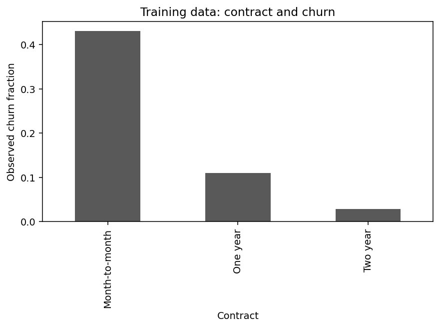

# Using CRISP-DM to build a practical customer retention queue

*A reproducible churn project with a fixed contact budget, honest evaluation, and a working batch scorer.*

By Praneeth Kalangi

## The decision before the model

A retention team has a simple operational problem: there are more customers than staff can review. A useful analysis should help decide whom to review while keeping the workload manageable.

For this project, I used a scenario in which staff can contact at most 30% of a batch. That capacity is an assumption for the assignment. The Kaggle Telco Customer Churn dataset supplies the IBM educational/sample customer records, but it does not tell us whether an offer would keep a customer from leaving.

That distinction shaped the project. I measured whether a model could rank observed churn risk. I did not convert correct predictions into claims about prevented cancellations or revenue saved.

## Business understanding made the metric choice clearer

CRISP-DM begins with the business question. Here, a review queue mattered more than overall classification accuracy. A model could predict that everyone stays, appear reasonably accurate, and still give the team no useful queue.

I chose average precision to summarize ranking performance and recall to show how many historical churners the selected queue covered. The declared retrospective gate required average precision above prevalence and recall of at least 50%. Actual business success would need a later controlled pilot measuring incremental retention.

## Understanding the data exposed a small but important issue

The source contains 7,043 customers and 21 columns. TotalCharges looks numeric, but blank strings make it easy to handle incorrectly. Converting it to a numeric field reveals 11 missing values, all associated with zero tenure.

I recorded that pattern and used a training-fitted median imputer with a missingness indicator. I did not assume that every missing total should automatically become zero. That decision is explicit so someone reviewing the project can challenge it.

I split customers into training, validation, and test partitions before exploring predictive relationships. The contract summary and numeric plots use only training rows. Customer IDs are excluded from the predictors. Gender and senior status are reserved for descriptive auditing rather than included in the model.

## Preparation had to survive deployment

The preprocessing pipeline handles numeric imputation and scaling, then categorical imputation and one-hot encoding. It lives inside the fitted estimator, including during cross-validation.

This matters because a scaler fitted on all rows would use information from held-out data. It also matters later: the saved model must receive the same transformations as the training model. A separate spreadsheet of manually encoded values would make that consistency harder to maintain.

## Comparing models and fixing the queue rule

I compared a constant-probability baseline, logistic regression, and random forest candidates. Three training folds selected the best model using average precision. The selected forest used 120 trees, maximum depth 10, and minimum leaf size 15.

Validation data then selected a threshold that maximized F2 while selecting no more than 30% of validation customers. F2 emphasizes recall. The final test partition did not choose the model or threshold.

A threshold alone cannot guarantee the same contact fraction in every future batch. The delivered scorer therefore applies a second rule: rank eligible customers and cap the queue at floor(30% of the batch). Ties use input order. That small implementation detail makes the business constraint concrete.

## What the held-out results show

On 1,409 held-out customers, average precision was 0.630, compared with 0.265 for the constant-score baseline. The frozen threshold selected 421 customers, about 29.9% of the test set.

Of those selected customers, 245 had historically churned. Precision was about 58.2%, and recall was about 65.5%. The top-30% lift was approximately 2.19 relative to random ranking.

These are useful retrospective results. They do not mean 245 customers could have been saved. Some customers may leave regardless of the contact, and contacting others may have no effect. The supplied Churn label means departure within the last month; prospective feature timing remains unknown. A risk model estimates an outcome pattern; intervention effectiveness needs different evidence.

I also reported demographic group counts and selection rates. Those checks help expose differences that an overall metric can hide. Excluding a demographic field does not guarantee fairness because other features can carry related information.

## Completing the lifecycle

The final artifact includes the full preprocessing pipeline, model, required input fields, and frozen threshold. A reload test checks that saved and in-memory predictions agree. The batch command validates required columns and writes risk scores and queue membership to CSV.

A real pilot would still need a confirmed future outcome window, verified feature availability before cancellation, current data, an accountable owner, and a controlled retention experiment. The current dataset has limited timing information, so a random split cannot establish future performance under changing conditions.

CRISP-DM helped keep those questions visible through the project. The final output is an evaluated decision aid with explicit limits and a testable interface.

## Reproduce the project

Upload `project.ipynb` to Google Colab, select a fresh Python CPU runtime, and choose Runtime → Run all. The final cell exports generated artifacts to a project-specific ZIP.

The project folder contains the Colab notebook, equivalent Python script, detailed phase report, metrics, plots, fitted model, batch scorer, and verification checklist. Run the notebook from a fresh runtime and compare its output with artifacts/metrics.json. The source data downloads from Kaggle and is checked against a saved SHA-256.

Dataset: [Telco Customer Churn](https://www.kaggle.com/datasets/blastchar/telco-customer-churn). Methodology: [IBM CRISP-DM guide](https://public.dhe.ibm.com/software/analytics/spss/documentation/modeler/18.1.1/en/ModelerCRISPDM.pdf).

*Publication status: draft. AI assistance was used to prepare code and writing. The student must complete the recorded manual review and required external model critiques before claiming those steps are complete. Add the real repository and Colab links before publication.*
