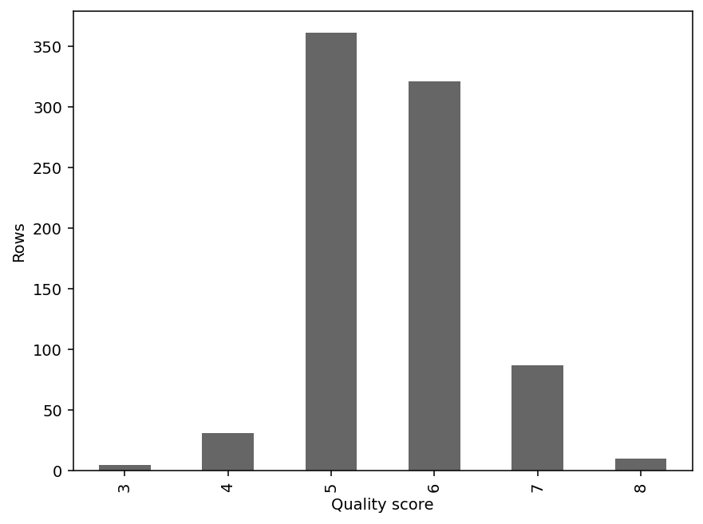
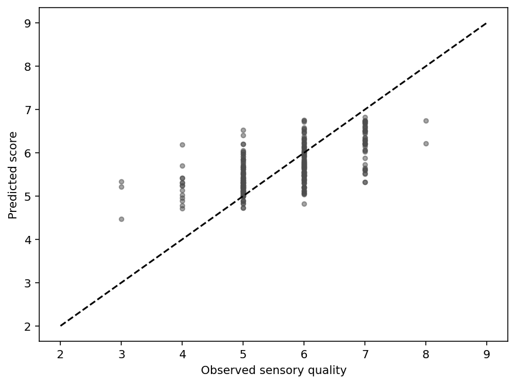

# Applying SEMMA to wine quality prediction without duplicate leakage

*A step-by-step regression project where the sample design matters as much as the estimator.*

By Praneeth Kalangi

## A laboratory question

Can routine laboratory measurements provide a useful preliminary estimate of a wine's sensory quality?

For this project, I used the Kaggle red wine quality dataset associated with the Portuguese Vinho Verde study by Cortez and colleagues. It contains 1,599 records, eleven physicochemical inputs, and a sensory quality score. The educational use case is assisting tasting-work allocation. It is not an automated product-quality or safety approval system.

I followed the five SEMMA stages: Sample, Explore, Modify, Model, and Assess. I implemented them in Python and added a batch scoring interface for delivery. I did not run SAS, so the project does not present Python output as SAS evidence.

## Sample: keeping repeated measurements out of the test boundary

The dataset is small enough to use in full. The important sampling decision was how to build honest partitions.

There are 240 additional rows identical in all measurements and the target. I collapsed them to 1,359 unique row vectors as an analytical weighting choice. The original study describes distinct samples per row, so equal values do not establish that these were duplicate physical wines. The reported results describe this collapsed dataset. Even after exact duplicate removal, identical predictor vectors could still have different target labels. Grouping identical chemistry keeps those feature vectors on one side of the evaluation boundary. This addresses potential memorization across the split without claiming the underlying wines are the same physical sample.

I grouped records using all eleven input measurements and kept those groups together in the training, validation, and test partitions. The same principle applies inside cross-validation. This makes the experiment harder to inflate through repeated measurements.

The split uses seed 42 and approximately 60/20/20 proportions. Exact counts can differ slightly because a chemistry group cannot be divided arbitrarily. The code saves a manifest and checks that no chemistry group crosses partitions.

## Explore: checking what the average could hide

Exploration uses training rows. I inspected the quality-score distribution, measurement summaries, correlations, and IQR flags.

The middle scores dominate. That means an overall error metric can look acceptable even if the model struggles with rare low- or high-quality wines. I kept that concern for the assessment stage, where I reported error separately by observed quality score with sample counts.

Some assays have unusually large values. An unusual measurement can be genuine, so I retained IQR-flagged rows rather than automatically removing them. The project has no independent evidence that those observations are measurement mistakes.

## Modify: making the transformation reproducible

All eleven assays enter the model, and quality remains the target. Median imputation and standardization live inside the pipeline.

Although the current source has no missing assay values, the imputer provides a documented rule for occasional missing values in future inputs. It does not make widespread missingness harmless. A laboratory pilot would still need to investigate incomplete or changed measurements.

Scaling supports ridge regression because assay magnitudes vary. The forest does not need scaling for its split decisions, but using a shared pipeline keeps the interface consistent. Each cross-validation fold fits its own preprocessing rather than borrowing distribution information from its validation rows.

The target is ordinal. Treating it as continuous is an approximation that makes MAE easy to interpret in score points. It does not prove that every adjacent score difference has exactly the same sensory meaning.

## Model: establishing a baseline first

The baseline predicts the training median score. That gives a useful reference because the median minimizes absolute error for a constant prediction.

I compared ridge regression at three regularization values with four random forest settings. Three grouped training folds selected the lowest MAE. The winning forest used 160 trees, unrestricted depth, and minimum leaf size 2.

The validation MAE was approximately 0.501 points. I kept the fitted model frozen for final assessment. I did not retrain on all rows after seeing the test result and then present the old metric as evidence for the new artifact.

## Assess: useful improvement with limits

On 272 held-out wines, the forest's MAE was approximately 0.534 points. The median baseline's MAE was 0.706. That is about a 24.4% reduction in absolute error for this split.

RMSE was about 0.684, and approximately 87.9% of predictions were within one score point of the observed quality. A 2,000-resample bootstrap interval for MAE was roughly 0.482 to 0.591 points.

The interval describes this fitted model and held-out sample. It does not include all uncertainty from retraining, unknown producer relationships, or a new region or vintage. Rare extreme labels have little evaluation support: MAE is 2.008 for score 3 (n=3) and 1.526 for score 8 (n=2), compared with 0.534 overall. The score-specific table matters alongside the headline number.

Validation permutation importance identifies inputs the model relies on, with alcohol and sulphates influential in this run. That is a predictive observation. It is not advice to change a wine's chemistry to improve a rating.

## Delivering a score that another person can reproduce

The saved artifact includes preprocessing and the estimator. The batch scorer checks the input columns, rejects invalid numeric text and infinite values, and returns continuous predicted quality on the documented 0–10 scale.

A serialization test confirms that loading the pipeline reproduces the original predictions. The notebook contains the complete scorer so it can run without a repository checkout. Dataset acquisition includes a saved checksum to make source changes visible.

A future laboratory pilot would need consistent assay units, batch/date identifiers, a new labeled cohort, and human ownership of final decisions. The model would need to be assessed again if those conditions change.

SEMMA gave the analysis a clear structure. The strongest lesson from this project was in the Sample stage: a sophisticated estimator cannot compensate for an evaluation boundary that lets repeated measurements cross it.

## Reproduce the project

Upload `project.ipynb` to Google Colab, select a fresh Python CPU runtime, and choose Runtime → Run all. The final cell exports generated artifacts to a project-specific ZIP.

The folder contains a Colab notebook, equivalent script, detailed SEMMA report, split manifest, metrics, plots, model, batch scorer, and an optional SAS demonstration plan. The SAS plan is explicitly unexecuted.

Data: [Kaggle Red Wine Quality](https://www.kaggle.com/datasets/uciml/red-wine-quality-cortez-et-al-2009). Original data: [UCI Wine Quality](https://archive.ics.uci.edu/dataset/186/wine+quality). Methodology: [SAS SEMMA overview](https://support.sas.com/documentation/cdl/en/emcs/66392/HTML/default/n0pejm83csbja4n1xueveo2uoujy.htm).

*Publication status: draft. AI assistance was used to prepare code and writing. Complete the student code review and required external critique evidence, then insert the real repository and Colab links before publishing.*
