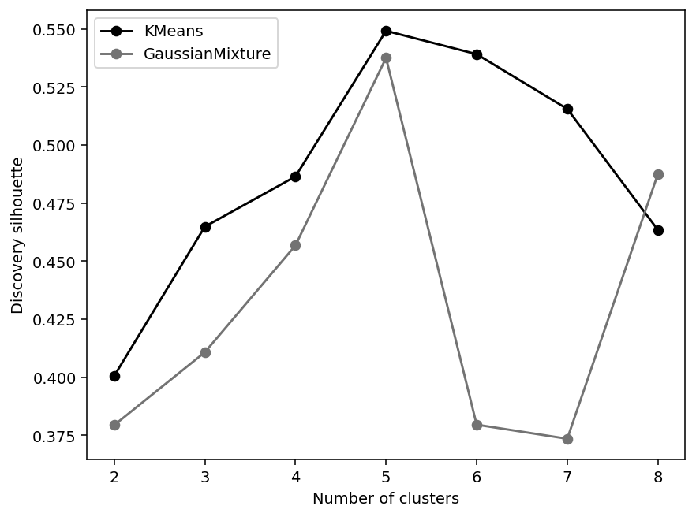
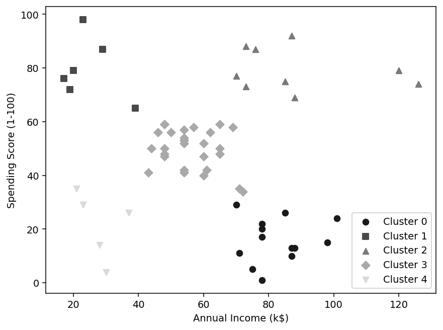

# Using KDD to test whether customer segments are worth interpreting

*A customer segmentation project with held-out confirmation, stability checks, and an explicit boundary between patterns and business results.*

By Praneeth Kalangi

## The question behind the scatter plot

A scatter plot of income and spending can make customer segmentation look easy. Fit KMeans, choose a few groups, and attach marketing labels.

For this project, I wanted to ask a more careful question: would the discovered patterns remain recognizable in customers excluded from fitting, and would the assignments survive modest changes in the discovery sample?

I used the Kaggle Mall Customer Segmentation dataset, which has 200 customers and five fields. KDD organized the work into selection, preprocessing, transformation, data mining, and interpretation/evaluation. I also included domain understanding and knowledge use through a crosswalk to the broader original process.

## Selection: deciding what a segment means

The primary features are annual income and spending score. CustomerID is an identifier, so its numerical distance has no useful similarity meaning. Gender is excluded, and Age is reserved for a separate sensitivity analysis.

That choice defines the question. It does not establish that two variables reveal a universal customer taxonomy. If the goal were age-related service planning, a different representation might be more suitable.

I split the source into 140 discovery customers and 60 confirmation customers using seed 42. Discovery rows support scaling and model selection. Confirmation rows assess the frozen model. The confirmation set comes from the same source, so it is internal evidence rather than proof that the result will transfer to another mall.

## Preprocessing: preserving legitimate observations

The code checks unique IDs, missing numeric values, positive income, and a spending-score range of 1–100. It records duplicate predictor vectors without automatically deleting them. Two people can have the same income and spending score.

I also retained extreme but valid incomes. An outlier can represent a legitimate customer. Deleting observations merely because they complicate KMeans would change the question and potentially hide a meaningful group.

The source does not provide transaction history, campaign responses, or enough detail to independently verify how Spending Score was constructed. Those limits matter when interpreting the final profiles.

## Transformation: units become a modeling choice

I standardized income and spending using only discovery rows. A one-standard-deviation difference in income then receives comparable distance weight to a one-standard-deviation difference in spending score.

That is an explicit assumption about similarity. It does not require that the measurements be normally distributed. It also explains why a saved scaler belongs inside the deployable model: recomputing it on a new batch would silently redefine distances.

Because the primary problem already has two dimensions, I did not add PCA. There was no need to hide a simple, interpretable feature space behind an unnecessary transformation.

## Data mining: comparing candidates using a declared rule

I compared KMeans and Gaussian mixtures for cluster counts from two through eight. Candidates needed every discovery cluster to contain at least 5% of the discovery sample. Among eligible fits, the highest discovery silhouette determined the winner.

I also saved Davies–Bouldin and Calinski–Harabasz indices, KMeans inertia, and Gaussian-mixture BIC. They provide context but measure different things. A BIC value and KMeans inertia are not interchangeable scores.

The search selected five KMeans clusters with a discovery silhouette of about 0.549.

## Interpretation needs more than a favorable fit

The frozen model assigned the 60 confirmation customers and achieved silhouette of about 0.556. That is encouraging because those customers did not choose the scaler, model family, or cluster count.

I then refitted the selected five-cluster KMeans pipeline on 30 subsamples containing 80% of discovery customers. Each iteration refits the scaler and the selected model. Stability is conditional on the selected family and cluster count; it does not repeat or test the stability of the full family/k search. Adjusted Rand Index compares the new assignments with the reference partition, accounting for arbitrary cluster label numbers. Median ARI was 0.981, with a minimum of 0.941. The complete results are stored so a weak iteration is not hidden by a single average.

A second diagnostic independently permutes income and spending while preserving their individual distributions. Its fitted silhouettes provide a reference for the role of cross-feature structure. This is not a formal p-value because the full model-selection search is not repeated in every permuted dataset.

I also added Age using the same model family and cluster count. Changes in assignment show that segmentation depends on the representation. They do not prove that either feature set is the only correct view of the customers.

## What the profiles can support

The five profiles describe higher and lower income/spending combinations plus a middle group. In the discovery sample, one higher-income/higher-score group has 30 customers, mean income about 85.9 thousand source dollars, and mean spending score about 83.0.

A marketing analyst could use that description to formulate a voluntary loyalty-offer hypothesis. The profile alone does not establish loyalty, profitability, or incremental response. Those claims need observed outcomes.

The useful output is therefore an interpretable hypothesis and a reproducible assignment rule. Cluster numbers are arbitrary. A later refit may use different numbers for similar groups, so model versions need profile descriptions rather than relying on “cluster 2” as a permanent customer identity.

## Knowledge use and the next experiment

The saved pipeline assigns new customers from income and spending score after checking the input schema and valid ranges. A reload check confirms matching assignments. The notebook includes the batch interface and its example output.

A real campaign should randomize treatment and control within a chosen group, define its response window before launch, and measure incremental outcomes and cost. Monitoring would also need to check data units, missingness, cluster proportions, and customers far from the learned profiles. Those are proposed next steps; no campaign or live monitoring service was run here.

KDD helped make the final claim narrower and more useful: these patterns are sufficiently structured to investigate, and the project makes the investigation reproducible.

## Reproduce the project

Upload `project.ipynb` to Google Colab, select a fresh Python CPU runtime, and choose Runtime → Run all. The final cell exports generated artifacts to a project-specific ZIP.

The folder includes the notebook, full report, nine-step crosswalk, model search table, confirmation profiles, stability results, figures, fitted pipeline, and batch scorer.

Dataset: [Mall Customer Segmentation Data](https://www.kaggle.com/datasets/vjchoudhary7/customer-segmentation-tutorial-in-python). Methodology: Fayyad, Piatetsky-Shapiro, and Smyth, [From Data Mining to Knowledge Discovery in Databases](https://fayyad.com/from-data-mining-to-knowledge-discovery-in-databases/).

*Publication status: draft. AI assistance was used to prepare code and writing. Complete the recorded manual review and external model critiques, then add actual repository and Colab links before publication.*

Audit exports: `null_reference.csv` retains every permuted diagnostic score; `cluster_assignments.csv`, `source_unit_centers.csv`, and `age_sensitivity_assignments.csv` support independent calculations without redistributing complete source rows.
